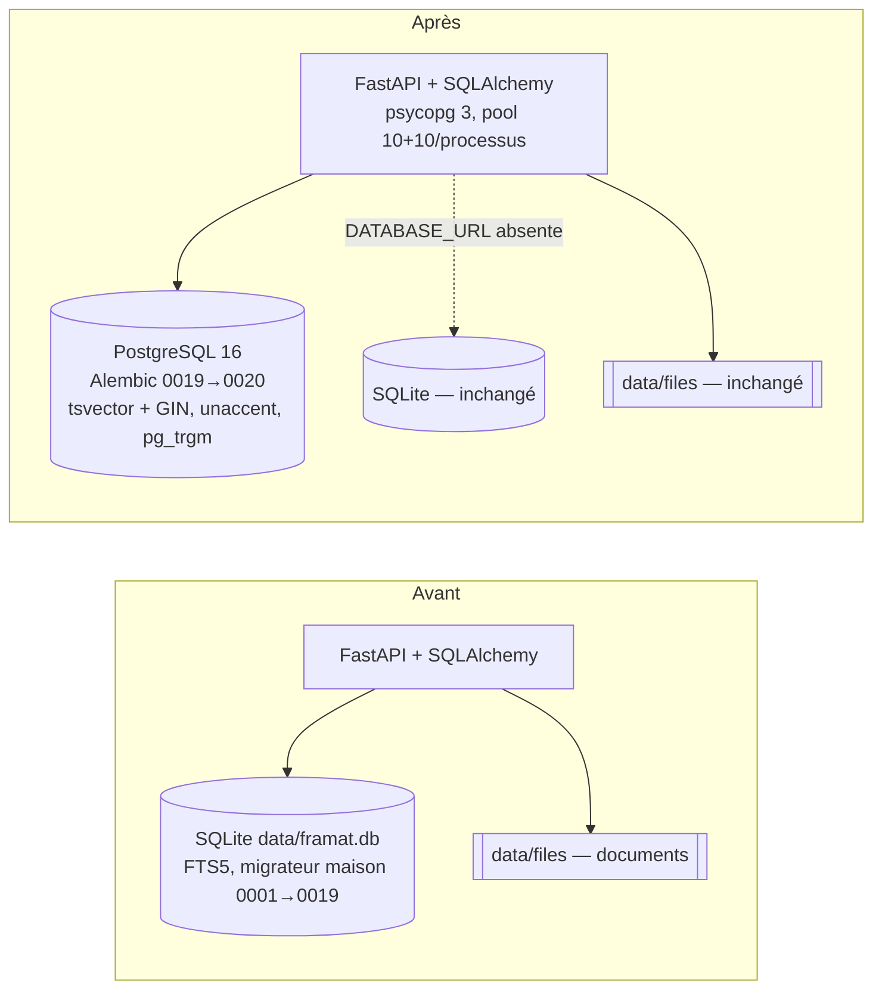

# FRAMATEX — Migration de SQLite vers PostgreSQL

Branche : `feat/postgresql-migration`, créée depuis `feat/enterprise-production-readiness`
(`c646ca0`). Cette dernière reste la **version de repli SQLite stable**. `main` n'a pas été modifiée.

Résumé :
- FRAMATEX fonctionne désormais **au choix** sur SQLite (par défaut, inchangé) ou sur
  PostgreSQL 16, selon `DATABASE_URL`.
- Le schéma PostgreSQL est géré par **Alembic** : 70 tables, 106 index, recherche `tsvector`.
- Un script **transfère** une base SQLite existante, sans jamais la modifier ; un second script
  **vérifie** le résultat ligne à ligne et fichier par fichier.
- Les suites Python (241 tests), JavaScript et Chromium passent sur les deux moteurs.
- Résultat de performance, sans enjoliver : **sur une seule machine, PostgreSQL n'est pas plus rapide
  que SQLite** pour FRAMATEX aujourd'hui (§ 7). Son intérêt est ailleurs : écritures concurrentes
  sans verrou de fichier, contraintes réellement appliquées, sauvegarde à chaud, réplication, et
  plusieurs serveurs d'application sur une même base.

---

## 1. Architecture avant / après



| Élément | Avant (SQLite) | Après (PostgreSQL) |
|---|---|---|
| Choix du moteur | fichier `data/framat.db` | `DATABASE_URL=postgresql+psycopg://utilisateur@hôte:port/base` ; mot de passe par `PGPASSWORD` ou `.pgpass`, jamais dans l'URL ni dans Git |
| Pilote | sqlite3 | psycopg 3 (`psycopg[binary]`) |
| Schéma | migrateur maison `app/migrate.py` (0001→0019) + verrou fichier | Alembic : `0019_baseline` (schéma complet) + `0020_postgresql_search` ; verrou consultatif `pg_advisory_lock` |
| Migrations au démarrage | automatiques | **refusées** si la base n'est pas à jour, sauf `FRAMATEX_AUTO_MIGRATE=1` : un seul processus migre (`python -m app.db upgrade`) |
| Recherche plein texte | table virtuelle FTS5 | table `document_search_index` : `tsvector` généré (configuration `simple`, minuscules et sans accents) + index GIN |
| Clés étrangères | déclarées, **non appliquées** (pragma absent) | appliquées strictement |
| Longueurs `VARCHAR(n)` | non contrôlées | contrôlées |
| Fuseau | dates naïves en UTC | session forcée en `timezone=UTC` |
| Garde-fous de session | `busy_timeout` 15 s | `statement_timeout` 30 s, `lock_timeout` 10 s, `idle_in_transaction_session_timeout` 60 s, `application_name=framatex` |
| Fichiers documentaires | `data/files` | **inchangé** : seules les références (nom disque, SHA-256) sont en base |
| Sauvegarde | API de sauvegarde SQLite + manifeste | `pg_dump -Fc` + manifeste ; vérification par restauration dans une base temporaire neuve |

---

## 2. Audit : incompatibilités relevées et traitement

Ont été inspectés : modèles (70 tables), routes, migrateur, contraintes, transactions, index, sessions
et permissions, SQL brut, FTS5, purge, sauvegardes, scripts Windows, tests et rapports précédents.

| # | Incompatibilité | Où | Traitement |
|---|---|---|---|
| 1 | Table virtuelle FTS5, `MATCH`, `snippet()` | `app/document_search.py` | Table `document_search_index` (`tsvector` généré + GIN), `to_tsquery` en préfixe, `ts_headline`. FTS5 conservé sous SQLite |
| 2 | `PRAGMA busy_timeout / foreign_keys / journal_mode` | `app/core.py` | Appliqués seulement si le moteur est SQLite ; options de session PostgreSQL à la place |
| 3 | Migrateur maison propre à SQLite (`sqlite_master`, recréation de tables, verrou fichier) | `app/migrate.py` | PostgreSQL : Alembic, sous verrou consultatif. SQLite : migrateur conservé tel quel |
| 4 | 8 index créés **uniquement** par le migrateur SQLite | `app/models.py` | Déclarés dans les modèles (`ix_audit_events_occurred_at`, `ix_document_versions_sha256`…) ; ils existent donc aussi sous PostgreSQL |
| 5 | Index unique partiel déclaré avec `sqlite_where` seul | `client_workflow_models.py` | Ajout de `postgresql_where` |
| 6 | `INSERT OR IGNORE` | `app/access_migration.py` | Exécuté seulement par la révision SQLite 0013. Sous PostgreSQL, le schéma part de 0019 : jamais appelé |
| 7 | Liste des tables lue dans `sqlite_master` | `app/document_purge.py` | `sqlalchemy.inspect()` (deux moteurs) |
| 8 | Contrôle de disponibilité lisant `schema_migrations` | `app/observability.py` | Lit `alembic_version` sous PostgreSQL ; indique le moteur |
| 9 | Clés étrangères non appliquées → orphelins possibles dans une base réelle | données | Détectés **avant** transfert ; le transfert est alors refusé, sans correction silencieuse (§ 4) |
| 10 | Longueurs, NULL interdits et booléens non contrôlés par SQLite | données | Même contrôle préalable bloquant |
| 11 | Recherche FTS5 sans préfixe (« comm » ne trouvait pas « commande ») | `document_search.py` | Préfixe ajouté aux **deux** moteurs : comportement identique |
| 12 | Épuisement du pool sous charge à plusieurs processus (5 erreurs à 75 utilisateurs) | `app/main.py` | Nombre de fils de travail par processus aligné sur la capacité du pool (`FRAMATEX_WORKER_THREADS`, 20 par défaut sous PostgreSQL) : une requête attend au lieu d'échouer |
| 13 | Tests utilisant `drop_all`/`create_all` sur SQLite | `tests/` | `tests/conftest.py` : base PostgreSQL remise au schéma Alembic à chaque réinitialisation |
| 14 | Scripts de recette, banc et charge forçant SQLite | `scripts/` | `scripts/recette_db.py` : base PostgreSQL **isolée** par recette (`FRAMATEX_RECETTE_DATABASE_URL`), créée puis supprimée |

Aucune autre construction propre à SQLite n'a été trouvée dans le code applicatif : pas de
`strftime`, `julianday`, `group_concat` ni `json_extract`, et pas de SQL brut hors des points ci-dessus.

---

## 3. Modifications

| Fichier | Rôle |
|---|---|
| `app/core.py` | Normalise `DATABASE_URL` (`postgresql://` devient `postgresql+psycopg://`) ; `IS_SQLITE` et `IS_POSTGRES` ; options du moteur selon la base |
| `app/migrate.py`, `app/db.py` | Migration PostgreSQL sous verrou consultatif ; outil `python -m app.db status / upgrade / downgrade <rév> / check` |
| `app/all_models.py` | Charge les 70 tables pour Alembic |
| `alembic.ini`, `migrations/` | `env.py` limité à PostgreSQL ; `0019_baseline` (tout le schéma) ; `0020_postgresql_search` (`unaccent`, `pg_trgm`, fonction IMMUTABLE `framatex_unaccent`, index de recherche) |
| `app/document_search.py`, `app/document_purge.py`, `app/observability.py`, `app/main.py`, `app/models.py` | Voir § 2 |
| `scripts/migrate_sqlite_to_postgresql.py` | Transfert (§ 4) |
| `scripts/verify_postgresql_migration.py` | Vérification (§ 5) |
| `scripts/make_migration_fixture.py` | Base SQLite de test réaliste (parcours complets, fictifs) |
| `scripts/backup_framatex.py` | Sauvegarde, vérification et restauration PostgreSQL (§ 9) |
| `docker-compose.postgresql.yml`, `.env.example` | PostgreSQL 16 local (port publié sur 127.0.0.1 uniquement, volume persistant) |
| `scripts/*postgresql_windows.{ps1,cmd}`, `scripts/wait_for_postgresql.py` | Démarrage, arrêt, migration, sauvegarde sous Windows (§ 8). **`scripts/start_windows.cmd` est inchangé** |
| `scripts/recette_db.py` + scripts de recette | Recettes sur base PostgreSQL isolée |
| `tests/conftest.py`, `tests/test_search_engine.py` | Tests exécutables sur les deux moteurs ; recherche (accents, préfixe, casse, dossier, droits) |
| `requirements.txt` | `psycopg[binary]>=3.2,<4`, `alembic>=1.13,<2` |

---

## 4. Transfert des données

`python scripts/migrate_sqlite_to_postgresql.py --sqlite <base> [--dry-run] [--replace]`

1. **Copie cohérente** de la base source par l'API de sauvegarde SQLite (lecture seule), puis
   `integrity_check`. **L'original n'est jamais ouvert en écriture** : son empreinte SHA-256 est
   identique avant et après, ce qui a été vérifié.
2. Mise de la **copie** à la révision 0019 par le migrateur historique, si la base est plus ancienne.
3. **Contrôles préalables**, identiques en simulation et en transfert réel :
   - valeurs plus longues que la colonne cible ;
   - NULL interdits ;
   - booléens invalides ;
   - lignes orphelines, pour chaque clé étrangère ;
   - doublons sur contrainte d'unicité ;
   - tables absentes de la source.

   Toute anomalie **bloque** le transfert. Le rapport la liste, et rien n'est corrigé.
4. Copie des 70 tables dans l'ordre des dépendances, en **une seule transaction**.
   - Sont conservés tels quels : identifiants, mots de passe hachés (aucune réinitialisation), NULL,
     zéros initiaux (colonnes texte), dates (UTC), éléments supprimés logiquement et historique.
   - Les fichiers ne bougent pas.
   - L'index de recherche est recopié depuis FTS5.
   - Les comptes sont vérifiés **avant** validation.
5. **Relance sans doublon** : le script refuse une base cible non vide. `--replace` vide puis recopie,
   dans la même transaction (tout ou rien).
6. Rapports JSON et Markdown dans `data/migration-reports/`.

**Résultats** sur la base de test réaliste (70 tables, 512 lignes, 71 fichiers ; index de
recherche 5/5) :
- la simulation est prête et ne touche pas la cible ;
- le transfert réussit ;
- une relance est refusée ;
- `--replace` réussit ;
- l'empreinte de l'original est inchangée.

Une base volontairement abîmée (ligne orpheline, valeur trop longue) est **refusée** à la simulation
comme au transfert, et PostgreSQL reste vide.

## 5. Vérification d'intégrité

`python scripts/verify_postgresql_migration.py --sqlite <base> --files-dir <data>` contrôle :

- les comptes par table ;
- les identifiants, et une **empreinte normalisée de chaque ligne** des deux côtés (même contenu
  exact) ;
- l'absence d'orphelins sous PostgreSQL, pour chaque clé étrangère ;
- l'index de recherche ;
- la révision du schéma ;
- la présence de chaque fichier documentaire (versions internes et documents client) et son
  **SHA-256** recalculé.

Le script produit un rapport détaillé des anomalies et ne corrige rien. Il renvoie le code 0
uniquement si tout est conforme.

**Résultats** :
- la base transférée est conforme ;
- les anomalies injectées après coup sont toutes détectées : ligne modifiée côté PostgreSQL, orphelin,
  fichier supprimé, empreinte différente.

## 6. Recherche PostgreSQL

- `document_search_index.search_vector` est une colonne générée :
  `to_tsvector('simple', lower(framatex_unaccent(titre + type + nom de fichier + texte extrait)))`,
  indexée en GIN.
- La configuration `simple` est voulue : pas de racinisation française, qui altérerait les
  références (« OF-00012 », codes article). Les accents et la casse sont neutralisés par `unaccent`
  et `lower`.
- Les requêtes sont en préfixe, chaque terme étant combiné par ET : `term:*`.
- La recherche par métadonnées (référence, client, atelier, OF…) passe toujours par les filtres SQL
  existants. Tous les critères, la recherche partielle et le filtre de dossier sont conservés.
- **Droits** : les identifiants trouvés sont filtrés par les mêmes règles d'accès (commande, dossier,
  action) **avant** de construire tout résultat ou extrait. Un technicien sans le dossier bleu
  n'obtient rien de ce dossier, ce que vérifie `tests/test_search_engine.py` sur les deux moteurs.
- `pg_trgm` est installé. Mesure : un index trigramme accélère un `LIKE` seul (15,6 ms → 0,4 ms), mais
  pas le préfiltre combiné de l'historique (OR sur plusieurs colonnes). Il n'a donc pas été ajouté
  (§ 12).

---

## 7. Performances et charge

Toutes les mesures ont été faites sur **la même machine de 4 vCPU (16 Go)**, partagée par
l'application, PostgreSQL 16 et le générateur de charge. Les résultats bruts sont dans
`docs/postgresql-load/`.

### 7.1 Requêtes unitaires

Base volumineuse : 200 commandes, environ 3 000 documents, 50 000 événements. Un utilisateur, médiane
de 15 appels.

| Requête | SQLite | PostgreSQL |
|---|---:|---:|
| Détail d'une commande | 9,9 ms | 19,7 ms |
| Complétude | 10,0 ms | 16,9 ms |
| Historique de la commande | 43,0 ms | 41,3 ms |
| Tableau de bord d'une commande | 61,9 ms | 60,5 ms |
| Recherche « BENCH-0001 » | 169 ms | 201 ms |
| Recherche « pièce » | 181 ms | 210 ms |
| Liste des commandes | 1 325 ms | 2 581 ms |
| Tableau de bord général | 2 539 ms | 3 597 ms |
| Corbeille | 7,1 ms | 4,7 ms |

**Lecture.** SQLite s'exécute dans le processus ; PostgreSQL paie un aller-retour réseau local par
requête SQL. Les écrans qui enchaînent beaucoup de petites requêtes sont donc plus lents sous
PostgreSQL :
- la liste et le tableau de bord général, dont le coût croît avec le nombre de commandes ;
- le détail d'une commande.

Ces deux écrans sont déjà les plus lents sous SQLite. Ils sont à optimiser quel que soit le moteur,
en regroupant les requêtes (§ 12).

### 7.2 EXPLAIN ANALYZE (PostgreSQL)

| Requête | Plan | Durée |
|---|---|---:|
| Révocation de session | Index Scan | 0,04 ms |
| Documents d'une commande | Index Scan | 0,15 ms |
| Recherche plein texte | Bitmap Index Scan sur le GIN | < 1 ms |
| Jointure de recherche et filtres | Index | 4,9 ms |
| Préfiltre de l'historique (LIKE sur plusieurs colonnes) | Seq Scan | 15,6 ms |

### 7.3 Montée en charge par paliers

Parcours mixte réel : connexion, listes, ouverture de commande, recherche, création de commande et
dépôt de documents. Le test s'arrête dès que le p95 dépasse 30 s.

| Configuration | Utilisateurs | req/s | Moyenne | Médiane | p95 | p99 | Erreurs |
|---|---:|---:|---:|---:|---:|---:|---:|
| SQLite, 1 processus | 10 | 30,5 | 255 ms | 116 ms | 1,2 s | 1,4 s | 0 |
| | 20 | 18,1 | 922 ms | 302 ms | 2,5 s | 9,2 s | 0 |
| | 30 | 10,7 | 2,5 s | 730 ms | 8,2 s | 28,0 s | 0 |
| PostgreSQL, 1 processus | 10 | 24,5 | 365 ms | 160 ms | 1,5 s | 2,0 s | 0 |
| | 20 | 15,8 | 1,1 s | 387 ms | 5,1 s | 10,5 s | 0 |
| | 30 | 10,5 | 2,4 s | 1,0 s | 13,6 s | 22,1 s | 0 |
| SQLite (WAL), 4 processus | 10 | 54,6 | 162 ms | 81 ms | 632 ms | 804 ms | 0 |
| | 20 | 37,7 | 354 ms | 143 ms | 1,4 s | 3,4 s | 0 |
| | 30 | 27,5 | 650 ms | 205 ms | 2,4 s | 8,9 s | 0 |
| | 50 | 22,9 | 1,3 s | 324 ms | 5,6 s | 20,0 s | 0 |
| | 75 | 28,8 | 2,1 s | 488 ms | 9,4 s | 23,0 s | 0 |
| | 100 | 13,8 | 5,1 s | 958 ms | 31,9 s | 90,5 s | 0 (arrêt) |
| PostgreSQL, 4 processus | 10 | 41,9 | 204 ms | 111 ms | 711 ms | 884 ms | 0 |
| | 20 | 35,4 | 452 ms | 156 ms | 2,2 s | 3,4 s | 0 |
| | 30 | 24,5 | 864 ms | 200 ms | 4,2 s | 10,0 s | 0 |
| | 50 | 17,0 | 2,2 s | 420 ms | 17,1 s | 28,9 s | 0 |
| | 75 | 14,2 | 3,9 s | 720 ms | 35,3 s | 54,7 s | 0 (arrêt) |

- Avant la limite du nombre de fils de travail, PostgreSQL à 4 processus produisait **5 erreurs**
  à 75 utilisateurs (pool épuisé). Après correction : **0**.
- Pour tous les paliers, l'intégrité est parfaite : 0 commande en double, 0 perte, chaque création
  confirmée est présente en base avec son événement d'audit.

### 7.4 Charge soutenue : 50 utilisateurs, 120 s, 4 processus

| | req/s | Médiane | p95 | p99 | Erreurs | CPU moyen | Mémoire de l'application | Intégrité |
|---|---:|---:|---:|---:|---:|---:|---:|---|
| SQLite (WAL) | 65 | 423 ms | 2,4 s | 4,5 s | 0 | 242 % | 1,46 Go | 506/506 |
| PostgreSQL | 53 | 343 ms | 3,4 s | 7,0 s | 0 | 229 % | 1,41 Go | 416/416 |

### 7.5 Conclusion objective

- **PostgreSQL n'est pas plus rapide** sur ce poste unique. Il est 15 à 50 % plus lent sur les écrans
  lourds, à charge égale.
- Ce banc est défavorable à PostgreSQL : le serveur partage 4 vCPU avec l'application et le
  générateur de charge.
- **La capacité tient au code applicatif**, pas au moteur. La liste et le tableau de bord général
  coûtent O(commandes) ; ce sont eux qui font monter le p95.
- **Fiabilité équivalente** : 0 erreur, 0 conflit et 0 perte sur les deux moteurs.
- PostgreSQL apporte en plus des garanties qu'aucun réglage SQLite n'offre :
  - clés étrangères et longueurs appliquées ;
  - écrivains concurrents sans verrou de fichier ;
  - sauvegarde à chaud standard ;
  - réplication et PITR ;
  - **plusieurs serveurs d'application** sur une même base, ce qui est impossible avec un fichier
    SQLite local.
- **Recommandation** :
  - SQLite reste adapté au poste unique et au pilote.
  - PostgreSQL est la base cible pour la production d'entreprise. Il doit tourner sur un serveur
    séparé (ou un service managé), avec les optimisations du § 12, avant de viser 75 à 100
    utilisateurs simultanés.

### 7.6 Connexions

- Chaque processus FRAMATEX ouvre au plus `pool_size + max_overflow` = 10 + 10 = **20** connexions.
- Règle : `processus × 20 + marge d'administration (≈ 10) < max_connections`. Exemple : 4 processus
  donnent 90, pour une limite de 100 (`docker-compose.postgresql.yml`).
- Au-delà, il faut augmenter `max_connections` avec la mémoire, ou ajouter PgBouncer.
- Aucune protection n'a été désactivée pour les mesures : cookies, CSRF, limitation de débit, audit et
  contrôles d'accès étaient actifs.

---

## 8. Installation sous Windows

> Rien n'a été installé sur votre ordinateur. Les étapes ci-dessous sont à suivre par vous.
> Les scripts PowerShell n'ont **pas pu être exécutés** dans l'environnement de développement
> (Linux, sans Windows ni Docker) ; leurs étapes Python ont été rejouées sous Linux (§ 10).

### 8.1 Option A : Docker Desktop (recommandée)

1. Installer **Docker Desktop pour Windows** depuis docker.com, avec le moteur **WSL 2**. Le programme
   d'installation propose d'activer WSL 2 ; sinon, exécuter `wsl --install` dans un PowerShell
   administrateur. Redémarrer le PC si demandé.
2. Lancer Docker Desktop et attendre « Engine running ».
3. Dans le dossier FRAMATEX :
   - copier `.env.example` en `.env` (`.env` n'est jamais versionné) ;
   - renseigner `FRAMATEX_PG_PASSWORD` avec un mot de passe long et aléatoire, propre à ce poste ;
   - laisser `FRAMATEX_PG_MODE=docker`.
4. Si ce n'est pas déjà fait, lancer une fois `scripts\start_windows.cmd` (création de `.venv`), puis
   l'arrêter.
5. Démarrer sur PostgreSQL :

   ```
   scripts\start_postgresql_windows.cmd            (ou : scripts\start_postgresql_windows.cmd -Demo)
   ```

   Le script effectue, dans l'ordre :
   - il lit `.env` ;
   - il démarre le conteneur `framatex-postgres` (`docker compose`, volume `framatex_pgdata`) ;
   - il attend que la base réponde ;
   - il applique le schéma (`python -m app.db upgrade`) ;
   - il contrôle les extensions ;
   - il lance FRAMATEX avec le démarrage habituel. Les options de `start_windows` restent valables :
     `-Demo`, `-Port`, `-NoBrowser`.

6. Arrêter : Ctrl+C pour FRAMATEX, puis `scripts\stop_postgresql_windows.cmd` pour le conteneur. Les
   données restent dans le volume.

### 8.2 Option B : PostgreSQL installé directement sous Windows

1. Installer **PostgreSQL 16** avec le programme d'installation EDB (postgresql.org → Download →
   Windows). Garder le port 5432 et le service `postgresql-x64-16`. Le mot de passe du super-utilisateur
   `postgres` est demandé à l'installation : le conserver hors de FRAMATEX.
2. Ouvrir « SQL Shell (psql) » en tant que `postgres` et exécuter, en remplaçant le mot de passe :

   ```sql
   CREATE ROLE framatex LOGIN PASSWORD 'mot-de-passe-long-et-aléatoire';
   CREATE DATABASE framatex OWNER framatex ENCODING 'UTF8' TEMPLATE template0;
   \c framatex
   CREATE EXTENSION IF NOT EXISTS unaccent;
   CREATE EXTENSION IF NOT EXISTS pg_trgm;
   ```

   Les extensions sont livrées avec l'installeur EDB. Les créer ici évite de donner le rôle
   super-utilisateur à `framatex`.
3. Dans `.env`, mettre `FRAMATEX_PG_MODE=local` et le même mot de passe dans `FRAMATEX_PG_PASSWORD`.
4. `scripts\start_postgresql_windows.cmd`. Si le service est arrêté, le script le démarre (droits
   administrateur nécessaires).

### 8.3 Commandes utiles

| Action | Commande |
|---|---|
| État du schéma | `.venv\Scripts\python -m app.db status` |
| Contrôle (révision, extensions, pgvector) | `.venv\Scripts\python -m app.db check` |
| Appliquer les migrations (un seul processus) | `.venv\Scripts\python -m app.db upgrade` |
| Revenir à une révision | `.venv\Scripts\python -m app.db downgrade 0019` |
| Sauvegarder | `scripts\backup_postgresql_windows.cmd -Dest D:\Sauvegardes` |
| Revenir à SQLite | `scripts\start_windows.cmd` (n'utilise pas PostgreSQL) |

Les commandes `python -m app.db` lisent `DATABASE_URL` et `PGPASSWORD` : les scripts `.cmd` les
préparent à partir de `.env`. En dehors des scripts, il faut les définir dans la console courante.

### 8.4 Migrer votre base locale existante (manuel, jamais automatique)

1. Arrêter FRAMATEX (Ctrl+C) : aucune écriture ne doit avoir lieu pendant le transfert.
2. Faire une sauvegarde SQLite :
   `python scripts\backup_framatex.py backup --data-dir data --dest D:\Sauvegardes`.
3. Lancer `scripts\migrate_to_postgresql_windows.cmd`. Le script :
   - démarre PostgreSQL ;
   - lance la **simulation**. Si elle trouve des anomalies, il s'arrête, et le rapport est dans
     `data\migration-reports\` ;
   - demande de taper **`OUI`** ;
   - effectue le transfert ;
   - lance la **vérification complète**.
4. Si tout est conforme : démarrer désormais avec `scripts\start_postgresql_windows.cmd`.
   `data\framat.db` reste intact.
5. Pour une relance volontaire sur une base PostgreSQL déjà remplie :
   `scripts\migrate_to_postgresql_windows.cmd -Replace`.

---

## 9. Sauvegarde, restauration, retour arrière

- **Sauvegarde.** `python scripts/backup_framatex.py backup --data-dir data --dest D:\Sauvegardes`,
  avec `DATABASE_URL` PostgreSQL.
  - Produit une archive contenant `database.dump` (`pg_dump -Fc`), les fichiers documentaires et
    `manifest.json`, avec le moteur, la révision, les comptes par table et le SHA-256 de chaque
    fichier.
  - `pg_dump` est celui du PATH, ou à défaut celui du conteneur.
- **Vérification.** `… verify <archive>` restaure dans une base temporaire **neuve**, compare les
  comptes, contrôle les fichiers, puis supprime cette base.
- **Restauration.** `… restore <archive> --to D:\Restauration --pg-database framatex_restauration`
  crée une base **nouvelle** et refuse une base existante : la base en service n'est jamais écrasée.
  On bascule ensuite en changeant `FRAMATEX_PG_DATABASE`.
- **Résultats** :
  - archive de 180 Ko, révision 0020 ;
  - vérification conforme (68 versions de documents) ;
  - restauration dans `framatex_restauration` conforme ;
  - écrasement refusé ;
  - la sauvegarde SQLite fonctionne toujours.
- **Retour arrière vers SQLite.**
  - *Avant* la mise en service sur PostgreSQL : rien à faire. `data\framat.db` est intact ; relancer
    `scripts\start_windows.cmd`.
  - *Après* : les écritures faites sous PostgreSQL **n'existent pas** dans SQLite, et aucun outil de
    retour PostgreSQL → SQLite n'est fourni. Pour ne rien perdre silencieusement :
    1. figer les écritures (arrêt de FRAMATEX) ;
    2. sauvegarder PostgreSQL ;
    3. conserver `framat.db` en **lecture seule**, comme photographie de la bascule ;
    4. ne jamais écrire dans les deux bases en parallèle.

    Un retour à SQLite signifie donc revenir à l'état de la bascule. Les saisies postérieures sont à
    reprendre à partir de la sauvegarde PostgreSQL et de l'historique d'audit. D'où la recommandation
    d'une période de recette courte, puis d'une bascule nette.

---

## 10. Vérifications fonctionnelles sous PostgreSQL

Toutes les recettes ont été exécutées sur PostgreSQL 16, chacune dans sa **propre base neuve**
(`FRAMATEX_RECETTE_DATABASE_URL`), avec le schéma installé par Alembic. Les parcours navigateur
(Chromium) font de vrais clics pour l'administrateur, le technicien et le client.

| Suite | Contenu | Résultat |
|---|---|---|
| Tests Python (`pytest`) | API, droits, documents, purge, rétention, recherche, client, sessions | **241/241** sous PostgreSQL, **241/241** sous SQLite |
| Tests JavaScript (`node --test`) | Interface | OK |
| `qa_platform_review` | Revue complète de la plateforme | 96/96 |
| `demo_full_platform` | Démonstration intégrale : interne et Client, doublons, versions V1→V3 | 135/135 |
| `validate_buttons_profiles_ui` | Boutons par profil (administrateur, technicien…) | 135 actions, 0 erreur JS, 0 requête en échec |
| `validate_costume_technician` | **Régression Costume** : technicien, sous-dossier bleu, dépôt et consultation | 7/7 |
| `validate_document_purge_ui` | **Suppression définitive** ; compteurs à jour ; copie identique conservée sans faux doublon | 9/9 |
| `validate_document_deletion_ui` | Corbeille, restauration, suppression | 5/5 |
| `validate_document_reliability_ui` | **Doublons**, **synchronisation des compteurs**, conflits | 19/19 |
| `validate_document_workspace` | Quatre sous-dossiers, PDF, Word, Excel, OCR réel, dépôt multiple et volumineux | 9/9 |
| `validate_business_requirements_ui` | 22 exigences standard, cas optionnels | 6/6 |
| `validate_business_memory_ui` | Mémoire métier | 11/11 |
| `validate_document_viewer_ui` | Visionneuse | 8/8 |
| `validate_client_workflow_ui` | Espace Client : inscription, approbation, demande, documents, acceptation et refus, transfert, documents partagés, compte suspendu | Scénario complet validé |
| `validate_access_ui` | Habilitations, y compris leur conservation après **redémarrage du serveur** | 15/15 |
| `validate_internal_ui` | Interface interne, 7 parcours, affichage à 390 px | 52 captures, 0 erreur JS |
| `validate_sessions_ui` | Sessions et révocation | 9/9 |
| `validate_landing_motion` | Page d'accueil et animations (dont mouvement réduit) | 31/31 |
| `validate_partnership_carousel` | Carrousel | 7/7 |
| `validate_cinematic_3d` | 3D, carrousel, alternatives statiques à 390 px | 4/4 |

**Anomalie corrigée pendant la recette.** Le contrôle « copie de base existante » des recettes copiait
le fichier SQLite pour rejouer la migration ; il échouait donc sous PostgreSQL, faute de fichier.
Sous PostgreSQL, il rejoue désormais `python -m app.db upgrade` **deux fois** sur la base de recette
remplie et compare les comptes de dix tables : aucune erreur, aucune ligne perdue. Le contrôle SQLite
d'origine est inchangé et passe toujours.

**Démarrage Windows rejoué sous Linux** sur une base PostgreSQL neuve :
- `wait_for_postgresql`, `app.db upgrade`, `app.db check` (extensions présentes, pgvector absent) ;
- contrôles préalables (`windows_preflight db`) ;
- création du compte de démonstration et jeu de démonstration A–E, sans doublon ;
- superviseur `windows_runtime serve --check-only` : état « ready », 0 erreur.

**Persistance.** Le test effectue, dans l'ordre :
1. création d'une commande (référence `000123`) et dépôt d'un document par l'API ;
2. arrêt et redémarrage du serveur ;
3. **redémarrage de PostgreSQL** (`pg_ctl restart -m fast`) ;
4. nouveau démarrage du serveur.

À chaque étape, la commande, la référence (zéros initiaux compris), le nombre de documents, la
recherche, le nombre de commandes et le **SHA-256 du fichier téléchargé**, égal à celui du fichier
déposé, sont identiques. Résultat : conforme.

**Non-régression SQLite** (sans `DATABASE_URL`) : `qa_platform_review` 96/96, `validate_document_workspace`
9/9, `validate_costume_technician`, `validate_document_purge_ui` 9/9, `validate_client_workflow_ui` :
tout est conforme. La base SQLite reste le moteur par défaut.

---

## 11. pgvector (étude seulement : rien n'est développé)

- `python -m app.db check` indique si l'extension `vector` est disponible. Elle ne l'est pas dans
  l'image `postgres:16.6-bookworm`.
- Pour la préparer :
  - Docker : remplacer l'image par `pgvector/pgvector:pg16`, compatible avec le même volume et la même
    version majeure ;
  - Windows natif : installer le paquet pgvector correspondant à PostgreSQL 16.
- Aucune migration ne crée `vector` aujourd'hui.
- Schéma envisagé pour plus tard :
  - table `document_chunks` (`version_id`, `launch_id`, `folder_slug`, `ordinal`, `text`,
    `embedding vector(n)`) ;
  - index HNSW ;
  - **filtrage par droits avant la recherche de similarité** : clause SQL sur
    `launch_id` / `folder_slug` issue des mêmes règles d'accès, jamais un filtrage après coup ;
  - suppression en cascade avec la purge définitive.
- L'agent, le chatbot, Ollama, le RAG et les embeddings **ne sont pas développés**, conformément à la
  demande.

## 12. Limites restantes

- **Scripts Windows.** Les scripts PowerShell n'ont pas pu être exécutés ici : pas de Windows ni de
  PowerShell ; le téléchargement de PowerShell 7 a été refusé par la politique de l'environnement.
  Le démon Docker n'est pas disponible non plus.
  - Le fichier Compose est validé (`docker compose config`).
  - Les étapes Python appelées par les scripts ont été rejouées sous Linux sur une base PostgreSQL
    neuve : `wait_for_postgresql`, `app.db upgrade` et `check`, contrôles préalables, création du
    compte de démonstration, jeu de démonstration, superviseur `windows_runtime serve --check-only`
    (prêt, 0 erreur).
  - **Premier lancement sous Windows à faire par vous**, en suivant le § 8.
- **Performance.** La liste des commandes et le tableau de bord général coûtent O(commandes) en
  requêtes ; ils sont plus lents sous PostgreSQL (§ 7.1). Prochaine optimisation : agrégations en une
  requête.
- **Historique.** Le préfiltre `LIKE` sur plusieurs colonnes fait un parcours séquentiel (15,6 ms sur
  50 000 événements). Un index trigramme par colonne avec réécriture en `UNION` est à évaluer si le
  volume grandit.
- **Recherche.** La configuration `simple` ne racinise pas : « commandes » ne trouve pas « commande »
  sans préfixe. C'est un choix fait pour protéger les références ; à revoir si les utilisateurs le
  demandent.
- **Banc de mesure.** Une seule machine partagée : les chiffres absolus ne préjugent pas d'un serveur
  PostgreSQL dédié.
- **Retour arrière** limité à l'état de la bascule (§ 9).

## 13. Version

Code et recettes validés au commit `e5e84773f92038f446da44e117fdb20a51bb5baa` (branche `feat/postgresql-migration`).
Le commit suivant n'ajoute que cette section. Le SHA de tête poussé figure dans le message de fin de
mission ; il se vérifie avec `git ls-remote origin feat/postgresql-migration`.
