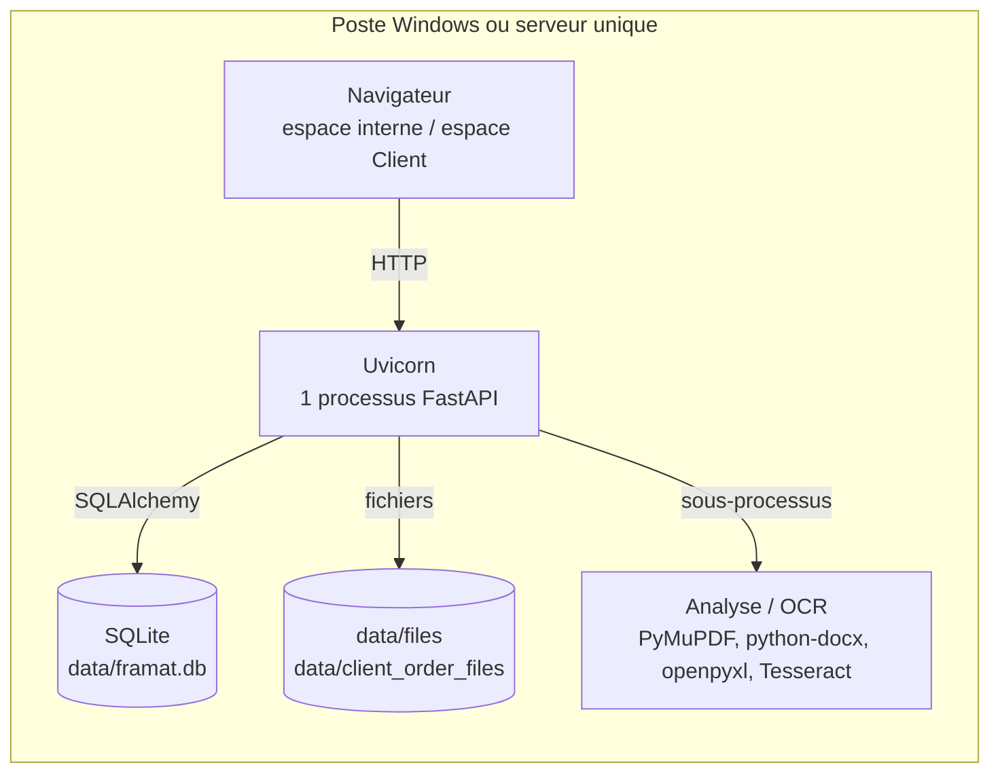
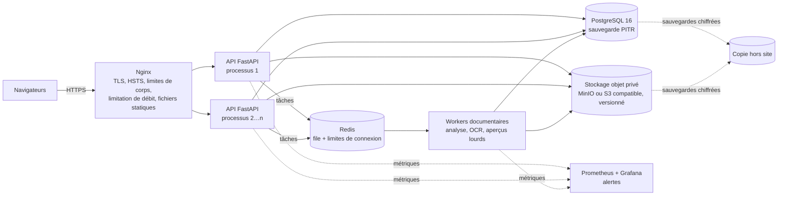

# FRAMATEX — Architecture de production

Document de référence pour le responsable informatique. Il décrit l'existant (constaté dans le code de
la branche `feat/enterprise-production-readiness`), l'architecture recommandée et trois configurations
dimensionnées selon la taille de FRAMATEX. Les capacités citées sont celles **mesurées** (voir
`ENTERPRISE_PRODUCTION_READINESS_REPORT.md`) ; tout le reste est une recommandation à valider.

## 1. Architecture actuelle

| Brique | Constat |
|---|---|
| Application | FastAPI, un seul processus Uvicorn (`scripts/start_windows.ps1`), endpoints synchrones exécutés dans le pool de threads (40) |
| Base | SQLite, fichier unique ; migrateur maison (`app/migrate.py`, révisions 0001→0019, sauvegarde automatique avant migration) ; `busy_timeout` 15 s ; **clés étrangères non appliquées** (`PRAGMA foreign_keys` absent) ; recherche plein texte FTS5 |
| Sessions | Cookie HttpOnly `SameSite=Strict`, jeton JWT HS256 8 h avec identifiant révocable (journal d'audit) ; `Secure` si `FRAMATEX_COOKIE_SECURE=1` ; en-tête anti-CSRF `X-Framatex-Request` obligatoire sur toute écriture |
| Habilitations | Point de contrôle unique `access_control.can(user, action, sous-dossier, commande)`, commande résolue par un intergiciel pour chaque requête |
| Documents | Stockage local, nom aléatoire, empreinte SHA-256 en base ; analyse et OCR dans un sous-processus borné (2 simultanés, délai) ; aperçus rendus côté serveur |
| Supervision | `/api/health`, `/api/health/ready`, journal d'accès JSON avec `X-Request-ID`, `/metrics` Prometheus protégé par jeton (ajoutés dans cette branche) |
| Sauvegarde | `scripts/backup_framatex.py` (ajouté) : copie en ligne cohérente, manifeste SHA-256, restauration vérifiée |

## 2. Architecture recommandée

Principes :

1. **Le serveur reste la seule source de vérité des droits.** Les workers et le futur agent IA
   appellent les mêmes fonctions d'habilitation (`can`) ou l'API ; aucun accès direct à la base qui
   contournerait un sous-dossier.
2. **Aucun traitement long dans une requête HTTP.** Le dépôt enregistre le fichier, crée une tâche
   (`en attente → en cours → terminé | échec → nouvelle tentative`) et rend la main ; l'écran suit l'état.
3. **État partagé hors des processus.** Limites de connexion, révocations de session et file de
   tâches dans PostgreSQL/Redis, pour fonctionner avec plusieurs processus.
4. **Stockage adressé par empreinte, versionné, chiffré au repos**, avec contrôle d'intégrité.

## 3. Flux

### 3.1 Requête authentifiée

Nginx (TLS) → intergiciel d'identifiant de requête → en-tête anti-CSRF → résolution de la commande et
contrôle d'accès (`access.guard_http_request`) → route → `can()` pour chaque action de sous-dossier →
réponse (en-têtes de sécurité, `Cache-Control: no-store` pour l'API).

### 3.2 Flux documentaire

Actuel : dépôt → fichier stocké → analyse/OCR (sous-processus, la connexion à la base est rendue au pool
pendant l'analyse depuis cette branche) → proposition de classement → décision humaine → publication
(version, empreinte, index plein texte, journal).

Cible : dépôt → objet stocké + tâche `analyse` → worker → résultat attaché à la version → notification
de l'écran (actualisation ciblée existante). Les aperçus PDF lourds et la génération de miniatures
passent aussi par les workers ; les aperçus courants restent synchrones et bornés.

### 3.3 Suppression définitive (ajoutée dans cette branche)

Corbeille (administrateur) → contrôle des dépendances métier et de la conservation → suppression des
lignes et des données dérivées dans **une** transaction, avec une ligne `storage_purge_queue` →
effacement du fichier **après** validation, repris au démarrage en cas d'interruption, jamais si le
fichier est encore référencé. Les sauvegardes existantes ne sont pas modifiées : un document détruit
reste présent dans les sauvegardes jusqu'à leur expiration (à indiquer dans la politique de
conservation).

## 4. Authentification et habilitations

- Conserver le modèle actuel (rôle Administrateur + affectations par commande et sous-dossier).
- Production : `FRAMATEX_ENV=production` (documentation d'API masquée), `FRAMATEX_COOKIE_SECURE=1`
  derrière HTTPS (HSTS automatique), secret `FRAMATEX_SECRET_KEY` ≥ 32 caractères dans un coffre.
- Avec plusieurs processus : déplacer le compteur d'échecs de connexion en base ou Redis (aujourd'hui
  en mémoire de processus : la limite serait multipliée par le nombre de processus).
- Étape suivante : authentification à deux facteurs pour les administrateurs ; SSO (OIDC) si FRAMATEX
  dispose d'un annuaire.

## 5. Base de données

**SQLite** convient au pilote et à une équipe de quelques dizaines de personnes sur un seul serveur :
écritures sérialisées (un seul écrivain), sauvegarde simple, aucun service à administrer. Limites
constatées : un seul écrivain, pas de réplication, migrateur limité à SQLite, clés étrangères non
appliquées, FTS5 propre à SQLite.

**PostgreSQL** est recommandé pour la production multi-processus. Stratégie sans perte (proposition,
non implémentée) :

1. Activer d'abord `PRAGMA foreign_keys=ON` sous SQLite en préproduction et corriger les violations
   (données orphelines) — prérequis pour des contraintes PostgreSQL strictes.
2. Adopter Alembic à partir de la révision 0019 (schéma figé comme base), sans réécrire l'historique.
3. Remplacer les éléments propres à SQLite : FTS5 → `tsvector` + index GIN (configuration `french`
   et `unaccent`), requêtes `sqlite_master` → `information_schema`, `PRAGMA` → paramètres de pool.
4. Copie des données par script (ordre des tables selon les dépendances), contrôle des volumes et des
   empreintes de chaque version, double exécution des recettes sur la copie.
5. Bascule pendant une fenêtre de maintenance, SQLite conservé en lecture seule comme repli.

## 6. Stockage documentaire

| Critère | Local actuel | Stockage objet privé (MinIO / S3 compatible) |
|---|---|---|
| Simplicité | Très simple | Service supplémentaire |
| Plusieurs serveurs | Non (disque partagé nécessaire) | Oui |
| Versionnement / verrou de rétention | Non | Oui (object lock possible) |
| Chiffrement au repos | Selon le disque (BitLocker, LUKS) | Natif |
| Sauvegarde | Copie de dossier + manifeste | Réplication + cycle de vie |

Recommandation : rester en local chiffré (BitLocker/LUKS) pour le pilote ; passer à MinIO quand plus
d'un serveur applicatif est nécessaire. À prévoir dans les deux cas : quotas par commande, antivirus
(ClamAV en worker, fichier en quarantaine tant qu'il n'est pas analysé), contrôle d'intégrité
périodique (empreintes en base ↔ fichiers).

## 7. Workers et Redis

Proposition (non implémentée) : RQ ou Celery avec Redis, une file `documents` (analyse, OCR,
miniatures, antivirus) et une file `maintenance` (vérification d'intégrité, effacements différés,
sauvegardes). Table `document_tasks` (état, tentatives, erreur, horodatages) pour l'affichage et la
reprise ; tentatives automatiques avec délai croissant, puis « échec » visible et relançable.

## 8. Supervision

- Collecte : journal d'accès JSON (stdout) vers un agrégateur (Loki ou fichier tournant), corrélé
  par `X-Request-ID` ; métriques `/metrics` (jeton) vers Prometheus ; tableau Grafana réservé à l'IT.
- Alertes proposées : `/api/health/ready` non 200 pendant 2 min ; p95 API > 2 s pendant 10 min ;
  taux de 5xx > 1 % ; espace disque < 15 % ; file d'effacement ou de tâches en attente > 1 h ;
  sauvegarde du jour absente ou non vérifiée.
- Aucune statistique technique dans les écrans métier.

## 9. Sauvegardes et continuité

| Élément | Fréquence proposée | Rétention proposée |
|---|---|---|
| Base + fichiers (`backup_framatex.py`) | Quotidienne (nuit) + avant chaque mise à jour | 14 jours quotidiennes, 12 mensuelles |
| Copie hors site chiffrée | Quotidienne | Selon la politique FRAMATEX |
| Secret et configuration | À chaque changement | Coffre séparé |

Objectifs à valider par FRAMATEX : **RPO 24 h** pour le pilote (une sauvegarde par nuit), **RPO 1 h**
en production (PostgreSQL avec archivage WAL) ; **RTO 4 h** (restauration vérifiée sur un poste de
secours). Un test de restauration mensuel est obligatoire : `backup_framatex.py restore … --to <dossier
vide>` contrôle la base et chaque fichier.

## 10. Configurations selon la taille

| | A. Pilote (≤ 20 utilisateurs) | B. Production PME (20–60) | C. Croissance (> 60, plusieurs sites) |
|---|---|---|---|
| Serveur | 1 VM ou poste dédié, 4 vCPU, 8 Go | 1 VM Linux 8 vCPU, 16 Go | 2+ VM applicatives |
| Application | Uvicorn 1 processus (actuel) | Docker Compose : Nginx + 2–4 processus + 1–2 workers | Idem, derrière répartiteur |
| Base | SQLite (sauvegarde quotidienne vérifiée) | PostgreSQL | PostgreSQL managé ou réplique |
| File | Aucune (analyses bornées) | Redis | Redis |
| Stockage | Disque local chiffré | Disque local chiffré ou MinIO | MinIO / S3 |
| Supervision | Santé + journal | Prometheus + Grafana | Idem + alerting centralisé |

Mesuré dans cette branche sur 4 vCPU, un processus, SQLite : voir le rapport (palier par palier).
La configuration A ne doit pas être étendue au-delà de la capacité réellement mesurée.

## 11. Déploiement

- **Environnements** : développement (poste, Windows conservé pour les démonstrations :
  `scripts/start_windows.cmd`), préproduction (copie de production anonymisée, recettes Chromium),
  production.
- **Docker Compose (proposition)** : `nginx`, `api` (image Python 3.13 + Tesseract fra), `worker`,
  `postgres`, `redis`, `minio` (option), volumes persistants nommés, secrets Docker. Les migrations
  s'exécutent dans un conteneur dédié avant le démarrage des processus API (jamais en parallèle).
- **Compatibilité multi-processus à traiter avant la configuration B** : limite de connexion en
  mémoire, compteurs `/metrics` par processus (agrégés par Prometheus), migration au démarrage de
  chaque processus (à sortir du `lifespan`), effacements de fichiers (déjà idempotents).
- Aucun déploiement n'a été lancé dans le cadre de cette mission.
